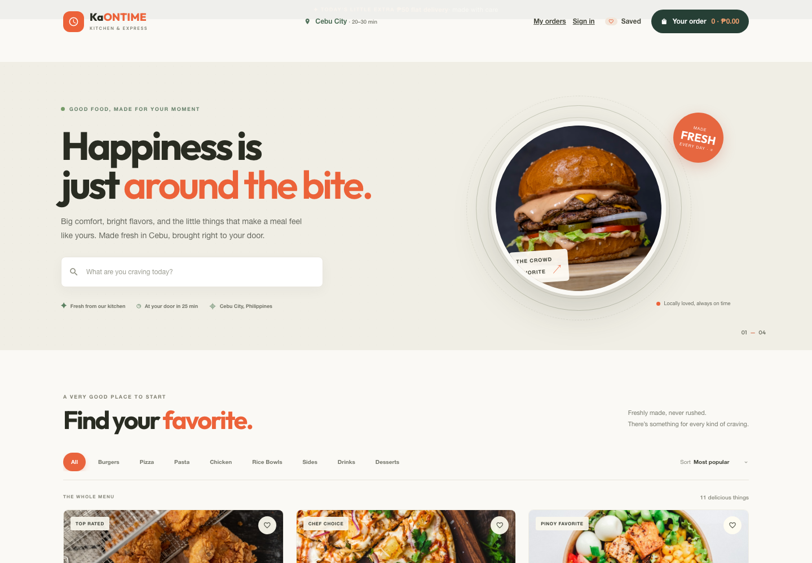
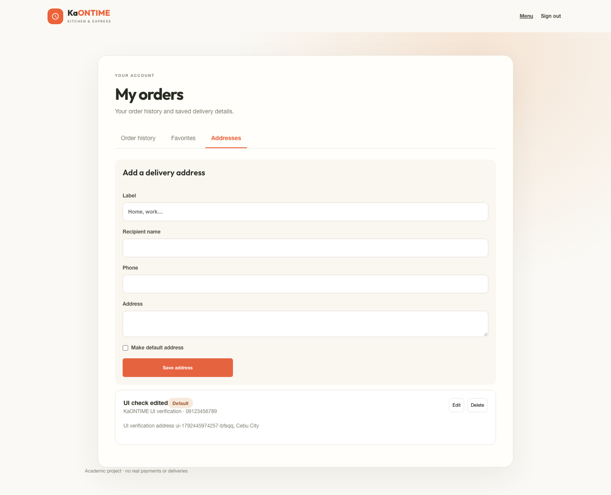
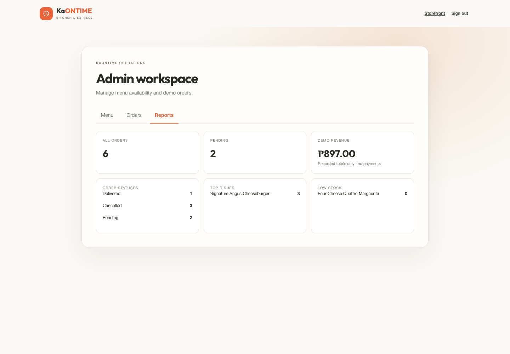

# IT Elective 4 — Project Progress Submission

## Project title

**KaONTIME — Food Ordering and Kitchen Management System**

Continuation of Activity 1, developed with Laravel, Vue 3, Quasar, TypeScript, Pinia, Axios and PostgreSQL. The Quasar application folder is named `VueActivity`.

## Complete names of group members

- **Jameboy Escartin** — name recorded in the existing project files; confirm the complete name before submitting.
- **Additional members: not provided.** Add their complete names here if this is a group submission. No names have been invented.

## Current progress

**90%** of the planned academic project.

The core customer and administrator workflows are implemented and verified against the hosted application. Remaining work concerns final submission details and optional final-period improvements, not a simulated backend.

## Completed features

1. Responsive storefront with menu search, categories, sorting, food imagery and persistent cart.
2. Running Laravel API connected to a dedicated Neon PostgreSQL database in **Singapore (`aws-ap-southeast-1`)**; the API function also runs in **Singapore (`sin1`)**.
3. Axios frontend/backend integration and an Activity page with a **Test Backend** button displaying **Hello World**.
4. Customer registration, sign-in, sign-out, expiring authentication tokens and protected administrator permissions.
5. Database-backed favorites and delivery addresses, including default-address selection and checkout autofill.
6. Authenticated checkout with server-calculated totals, promo validation, stock checks and saved order receipts.
7. Idempotent checkout retries to prevent duplicate order creation, and transactional stock updates.
8. Customer-private order history, order status and cancellation of pending orders with stock restoration.
9. Administrator menu create/edit/remove, prices, stock and availability controls; historical receipts survive menu removal.
10. Administrator order progression: Pending → Preparing → Out for Delivery → Delivered, with permitted cancellation rules.
11. Administrator reports for order counts, recorded order value, status distribution, popular dishes and low stock.
12. Hosted frontend and Laravel API, private GitHub repository, automated tests and reproducible verification scripts.

## Features currently being developed

- Submission finalization: confirm complete group-member names and add the instructor's editor/terminal screenshot if required.
- Planned developer-toolchain security upgrade; see the disclosed audit limitation below. No core customer/admin workflow is left as a mock interface.

No real payment processor or delivery service is presented as implemented. COD is a recorded payment-method choice; the application does not collect money or schedule actual deliveries.

## Next targets / planned features

- Email-based password recovery and email verification.
- Administrator image upload with validated storage, rather than choosing bundled image files.
- Optional order-status notifications and improved reporting filters/export.
- Commercial hardening: load testing, connection-pool compatibility work, monitoring, backups and a real payment/delivery integration if the project expands beyond coursework.

## Problems or issues encountered

- The original Activity 1 backend used Express/Prisma instead of Laravel. It was preserved locally and replaced by the required Laravel implementation.
- PHP and Composer were initially unavailable; they were installed, and database drivers were verified.
- The deployed community PHP runtime encountered PostgreSQL transaction failures on the Neon pooled connection. A controlled connection-setting check showed that the **direct/native-prepare configuration** works; the hosted integration checks now pass. The exact internal pooled-connection failure was not established, and high-traffic pooling remains a future hardening task.
- Frontend scaffold, store initialization, API field mapping, promo state, status-response and cancellation/retry issues were corrected and regression-checked.
- The owner requested **Hello World** instead of the rubric's personalized greeting. If the instructor requires a name, change the configurable `API_HELLO_MESSAGE` before taking the final Activity 2 screenshot.
- Additional group-member names are still needed if applicable.
- The npm audit reports **four development-toolchain advisories (one low, three high)** in the current Quasar CLI dependency tree. The available supported fix requires a broader Quasar CLI / Vue Router major-version migration; that migration was not forced into this release. The runtime-only npm audit reports **zero vulnerabilities**. This is a remaining maintenance issue, not a claim that all dependency advisories have been resolved.

## Verification performed

- Laravel: **13 tests, 94 assertions passed**.
- Hosted API: **48 HTTP checks passed** through the public frontend's API proxy, including customer isolation, role protection, favorites, addresses, authoritative totals, idempotency, cancellation stock restoration, token revocation, administrator reports/product CRUD, and customer-versus-admin cancellation permissions.
- Real hosted browser flow passed: registration, favorites, address CRUD/default/use, checkout, receipt, customer cancellation, session reload/logout/re-login, admin product edit, order progression, reports and mobile overflow check.
- Frontend production build, TypeScript and ESLint checks passed.
- Screenshots below were captured from the actual hosted application; they are not mockups.

## Three current-progress screenshots

### 1. Main / Home page

### 2. Customer account and saved addresses

### 3. Administrator reports

## Additional Activity 2 evidence

- [Frontend displaying the Laravel greeting](screenshots/current/activity-hello-world.png)
- [`/api/hello` in the browser](screenshots/current/api-hello-world.png)
- [Laravel database health endpoint](screenshots/current/laravel-health.png)
- [Checkout](screenshots/current/checkout-desktop.png)
- [Saved order confirmation](screenshots/current/receipt-desktop.png)
- [Customer order history](screenshots/current/orders-desktop.png)
- [Administrator order management](screenshots/current/admin-orders.png)
- [Mobile home page](screenshots/current/home-mobile.png)

**Manual screenshot still needed if the instructor requires it:** VS Code showing the `backend` and `VueActivity` folders, plus the running terminal output. GUI automation did not have macOS accessibility permission. An API screenshot is not represented as a terminal/editor screenshot.

## Links

- Application: https://vueactivity-kaontime.vercel.app
- API activity page: https://vueactivity-kaontime.vercel.app/activity
- Repository: https://github.com/rexroze/KaONTIME (**private**; grant the instructor access if needed)

Do not include `.env`, `.vercel`, administrator credentials, database credentials, `vendor`, or `node_modules` in the submission archive.
